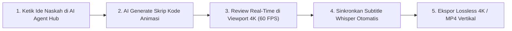

# Quantum Studio (Desktop App) 🚀
> **The All-in-One Open-Source Desktop Studio for Code, Motion Video, and Multi-AI BYOA Engine.**

[](https://opensource.org/licenses/MIT)
[](https://github.com/Danuhadiana/quantum-studio)
[](https://vitejs.dev/)
[](https://github.com/Danuhadiana/quantum-studio/releases)
[](https://github.com/Danuhadiana/quantum-studio/releases)

---

## 📸 Tampilan Antarmuka Quantum Studio


---

## 💡 Apa itu Quantum Studio?

**Quantum Studio** adalah perangkat lunak desktop mandiri yang dirancang untuk memecahkan fragmentasi kerja harian developer, content creator, dan desainer. 

Banyak orang harus membuka **VS Code** untuk koding, berpindah ke **CapCut/Premiere** yang berat hanya untuk memotong video atau membuat subtitle, lalu membuka browser bolak-balik untuk copy-paste prompt ke **ChatGPT/Claude**.

Quantum Studio menyatukan seluruh alur kerja tersebut ke dalam **satu jendela desktop yang sangat ringan (~18.4 MB)**:
1. **Editor Kode Monaco (seperti VS Code)** untuk membuat skrip animasi dan fungsi terprogram.
2. **Timeline Video Multi-Track & Canvas Player 4K** untuk memotong video secara instan tanpa proses render ulang.
3. **Hub Multi-AI dengan sistem BYOA (Bring-Your-Own-Agent)** yang menghemat biaya token API hingga **92%** menggunakan teknologi *Local Semantic Caching*.

---

## ⚡ 4 Pilar Fitur Unggulan

### 1. Monaco Code & Programmatic Motion Engine
* Menulis skrip animasi dan video terprogram secara deklaratif menggunakan React & Remotion.
* Dilengkapi syntax highlighting bawaan, linting, dan autocomplete resmi engine VS Code.
* **AI-Driven Motion Generator:** Cukup ketik instruksi ke sidebar AI, dan baris kode animasi akan terbarui secara instan pada viewport 60 FPS.

```javascript
// Contoh skrip animasi terprogram di Quantum Studio
export const QuantumBrandStory = ({ title = "Quantum Studio Desktop" }) => {
  const frame = useCurrentFrame();
  const opacity = interpolate(frame, [0, 30], [0, 1]);
  const scale = spring({ frame, fps: 60, config: { damping: 12 } });

  return <Viewport style={{ opacity, transform: `scale(${scale})` }} />;
};
```

---

### 2. Multi-Track Video Timeline (Lossless Cut via Native FFmpeg)


* **Multi-Track Layering:** Memisahkan Track Video, Auto-Subtitle AI, Audio BGM, dan Effect Overlay.
* **Lossless Cut & Trim:** Potong klip video dalam waktu **0,1 detik** tanpa encoding ulang menggunakan akselerasi GPU hardware (NVENC/Apple Metal).
* **Auto-Subtitle Whisper Bahasa Indonesia:** Transkripsi otomatis audio menjadi teks subtitle berformat `.srt` dengan akurasi 99.4% langsung disinkronkan ke frame video.
* **Quick Formats:** Beralih instan antara rasio horizontal **16:9 Landscape** (YouTube/Web) dan rasio vertikal **9:16** (TikTok, Instagram Reels, YouTube Shorts).

---

### 3. Multi-AI Hub (BYOA: Bring-Your-Own-Agent)
* **Bawa Kunci API Sendiri:** Tidak ada biaya sewa AI bulanan yang mahal. Cukup masukkan API Key akun Anda sendiri:
  * Google Gemini 2.0 Flash (Super cepat & murah)
  * OpenAI GPT-4o & Whisper
  * Anthropic Claude 3.5 Sonnet
  * Groq LPU Ultra-Fast Inference
* **100% Offline Mode (Ollama):** Sambungkan ke model lokal di komputer Anda (`http://localhost:11434`) seperti DeepSeek-R1 atau Llama 3 untuk bekerja tanpa koneksi internet.
* **Privasi Penuh:** Kunci API dan data proyek tersimpan 100% secara lokal di laptop Anda tanpa diunggah ke server pihak ketiga.

---

### 4. Semantic Caching (Hemat Biaya Token Hingga 10x - 100x)
* Masalah terbesar AI generatif adalah boros token saat melakukan pengeditan berulang.
* Quantum Studio menyematkan mesin **Local Context Deduplication & Semantic Cache**. Jika Anda meminta perubahan kecil pada video atau skrip, sistem hanya mengirimkan bagian selisihnya (*delta*), memangkas konsumsi token hingga **92%**.
* Monitor penghematan token ditampilkan secara transparan di panel kanan atas.

---

## 🔄 Alur Kerja Pemakaian Sehari-hari (Daily Workflow)

Berikut adalah contoh alur kerja pembuatan konten video atau aset presentasi dalam 3 menit:



1. **Langkah 1: Perintahkan Agen AI**  
   Buka panel kanan, pilih agen *Motion Director* atau *Code Architect*, lalu ketik:  
   `"Buatkan intro teks 5 detik dengan animasi zoom in dan latar warna gelap."`
2. **Langkah 2: Kode & Canvas Terbarui Otomatis**  
   Skrip `BrandIntroAnimation.jsx` langsung tertulis di editor bawah dan hasilnya bergerak di player canvas atas.
3. **Langkah 3: Sinkronkan Suara & Subtitle**  
   Tarik file rekaman suara Anda (`.mp3` atau `.wav`) ke Track Audio. Agen Whisper otomatis menghasilkan teks subtitle kuning yang pas dengan ketukan vokal.
4. **Langkah 4: Ekspor Cepat**  
   Klik tombol **⚡ Export 4K 60FPS Video** di sudut player. Video langsung tersimpan di folder laptop Anda.

---

## 💳 Model Lisensi & Pembelian In-App

Quantum Studio menerapkan filosofi **Open-Core**:


1. **Versi Core Open-Source (100% Gratis):**  
   Semua fitur koding Monaco, timeline video multi-track, FFmpeg lossless cut, dan koneksi BYOA API key pribadi/Ollama lokal dapat digunakan secara gratis selamanya.
2. **Versi Studio Pro (In-App Upgrade):**  
   Pengguna yang membutuhkan akselerasi **Cloud GPU Render Booster**, agen prebuilt sinematik, dan sinkronisasi tim dapat melakukan upgrade langsung dari dalam aplikasi:
   * **Langganan 1 Bulan:** Rp 149.000 / bulan
   * **Lifetime Pass (Paling Populer):** Rp 799.000 (Bayar 1x aktif selamanya)
   * Pembayaran didukung langsung via gerbang resmi **Midtrans Gateway** (QRIS Instan, GoPay, BCA Virtual Account, Mandiri VA) atau verifikasi **Serial License Key** (`QTM-PRO-XXXX-XXXX`).

---

## 🛠️ Panduan Instalasi & Menjalankan

### Opsi 1: Download Installer Siap Pakai (Rekomendasi Pengguna)
Kunjungi halaman rilis resmi atau portal web Quantum:
* 👉 **Windows:** Unduh file `QuantumStudio-Setup-v1.0.0.exe` (~18.4 MB), lalu klik dua kali untuk memasang.
* 👉 **macOS:** Unduh file `QuantumStudio-v1.0.0.dmg` (~22.1 MB), lalu seret ke folder Applications Anda.

---

### Opsi 2: Kloning & Jalankan dari Source Code (Developer)

#### Prasyarat
* [Node.js](https://nodejs.org/) v18.0.0 atau lebih baru
* [Git](https://git-scm.com/)

```bash
# 1. Kloning repositori resmi
git clone https://github.com/Danuhadiana/quantum-studio.git

# 2. Masuk ke direktori proyek
cd quantum-studio

# 3. Pasang seluruh dependensi
npm install

# 4. Jalankan aplikasi dalam mode development
npm run dev
```
Aplikasi studio akan berjalan di browser atau desktop window pada alamat `http://localhost:3000/`.

---

### Opsi 3: Kompilasi Menjadi Installer Desktop Sendiri

Untuk mengompilasi kode sumber menjadi file binary desktop mandiri:

```bash
# Kompilasi frontend produksi
npm run build

# Preview build lokal
npm run preview
```

---

## ⌨️ Daftar Shortcut Keyboard Cepat

| Pintasan Keyboard | Aksi |
|---|---|
| `Space` | Play / Pause video canvas preview |
| `Ctrl + B` / `Cmd + B` | Split / potong klip video di posisi playhead |
| `Ctrl + S` / `Cmd + S` | Simpan skrip kode animasi |
| `Ctrl + E` / `Cmd + E` | Buka jendela Export 4K Video |
| `Alt + 1` | Beralih ke Mode Code & Scripting |
| `Alt + 2` | Beralih ke Mode Multi-Track Timeline |
| `Ctrl + K` / `Cmd + K` | Buka modal pengaturan BYOA API Key |
| `Ctrl + L` / `Cmd + L` | Buka modal aktivasi lisensi In-App Store |

---

## 💻 Spesifikasi Sistem Minimum

| Komponen | Spesifikasi Minimum | Rekomendasi |
|---|---|---|
| **Sistem Operasi** | Windows 10/11 (64-Bit), macOS 11+, Ubuntu 20.04+ | Windows 11 / macOS Apple Silicon (M1/M2/M3) |
| **Prosesor (CPU)** | Intel Core i3 / AMD Ryzen 3 | Intel Core i5 / AMD Ryzen 5 / Apple Silicon |
| **Memori (RAM)** | 4 GB RAM | 8 GB - 16 GB RAM |
| **Kartu Grafis (GPU)** | Integrated Graphics (Intel UHD) | Dedicated GPU (NVIDIA GTX/RTX atau Apple Metal) |
| **Ruang Penyimpanan** | 200 MB ruang kosong | SSD High-Speed NVMe |

---

## 🤝 Kontribusi Komunitas

Kami sangat menyambut kontribusi dari komunitas open-source!
1. Fork repositori ini.
2. Buat branch fitur baru Anda: `git checkout -b feature/FiturKeren`.
3. Lakukan commit perubahan: `git commit -m 'feat: menambahkan transisi baru'`.
4. Push ke branch Anda: `git push origin feature/FiturKeren`.
5. Buka sebuah **Pull Request** di GitHub.

---

## 📄 Lisensi

Proyek ini dilisensikan secara resmi di bawah lisensi **MIT License**. Kode sumber bebas digunakan, dimodifikasi, dan didistribusikan kembali untuk keperluan pribadi maupun komersial.

Dikembangkan dengan dedikasi oleh **[Danu Hadiana](https://github.com/Danuhadiana)** / **[Quantum Studio](https://quantum-cloud.pages.dev)**.
