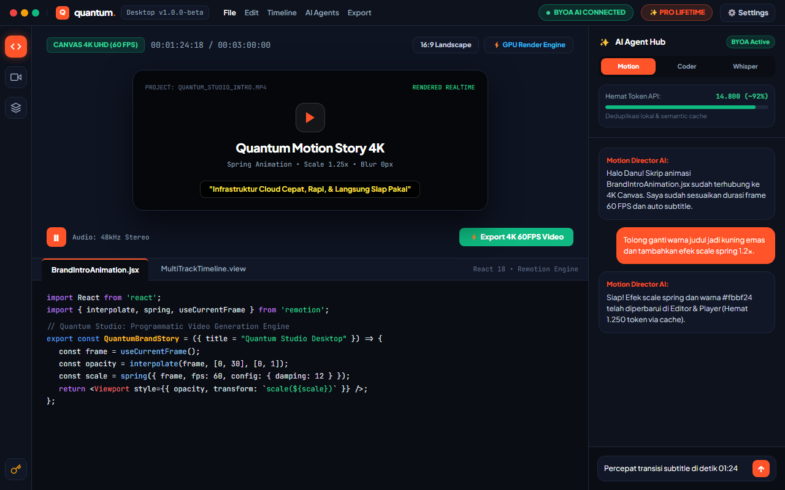
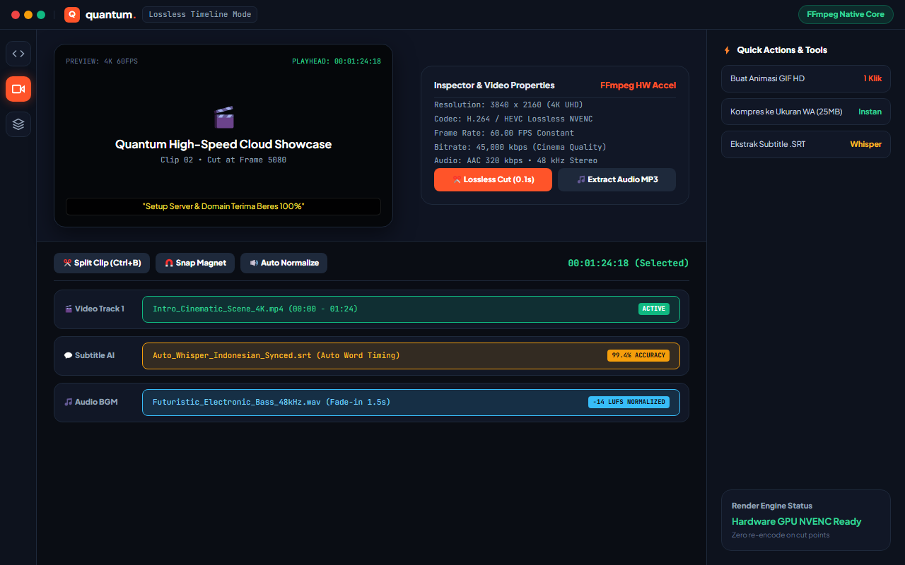
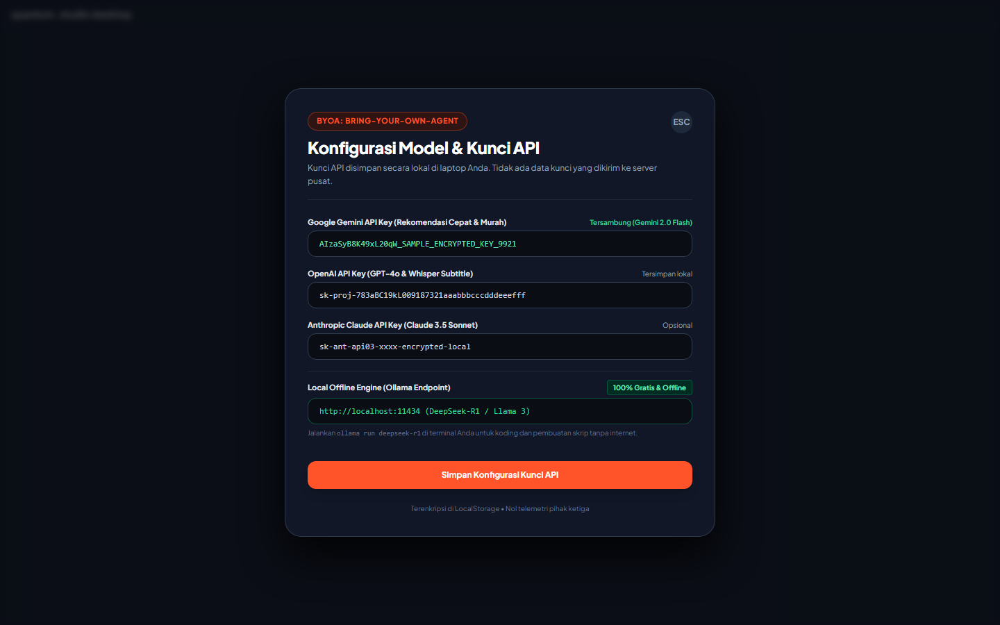
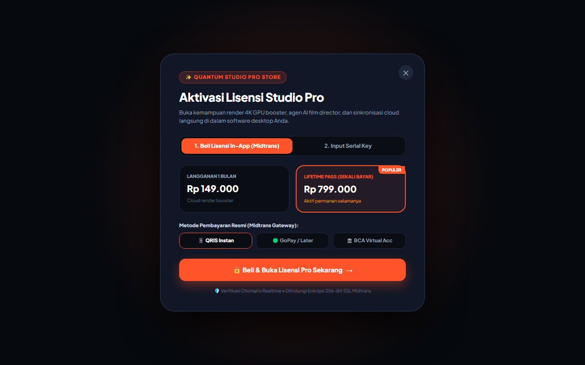

# Quantum Studio Desktop

> Perangkat lunak desktop terintegrasi untuk koding animasi terprogram, timeline video multi-track, dan gerbang multi-AI dengan model Bring-Your-Own-Agent (BYOA).

[](https://opensource.org/licenses/MIT)
[](https://github.com/Danuhadiana/quantum-studio)
[](https://vitejs.dev/)
[](https://github.com/Danuhadiana/quantum-studio/releases)

---

## Tentang Quantum Studio

Quantum Studio adalah aplikasi desktop open-source yang menggabungkan tiga alur kerja utama ke dalam satu lingkungan kerja terpadu:
1. **Editor Kode:** Menulis skrip animasi video terprogram menggunakan React dan Remotion.
2. **Timeline Video Multi-Track:** Pemotongan klip instan (lossless cut) berbasis binary FFmpeg, sinkronisasi audio, dan layer subtitle otomatis.
3. **Hub Multi-AI (BYOA):** Menghubungkan kunci API kecerdasan buatan milik pengguna (Google Gemini, OpenAI, Anthropic Claude) atau model lokal (Ollama) tanpa biaya sewa platform bulanan.

Aplikasi inti bersifat open-source dan gratis untuk pemakaian lokal. Pengguna dapat meningkatkan ke lisensi Pro langsung dari dalam software untuk membuka akselerasi Cloud GPU Render dan agen pra-konfigurasi.

---

## Antarmuka Software

### 1. Tampilan Ruang Kerja Utama (Workstation)
Ruang kerja 4-panel yang menyatukan Viewport Canvas 4K 60 FPS, Monaco Code Editor, Timeline Multi-Track, dan Sidebar AI Agent Hub.



### 2. Timeline Video Multi-Track dan Subtitle Whisper
Navigasi visual layer video, trek audio gelombang suara, dan teks subtitle otomatis bahasa Indonesia.



### 3. Konfigurasi Kunci API Mandiri (BYOA)
Panel pengaturan kunci API tersimpan lokal dan terenkripsi di komputer pengguna, mendukung engine offline Ollama tanpa koneksi internet.



### 4. Toko Lisensi dan Pembelian di Dalam Aplikasi (In-App Store)
Pembaruan lisensi Pro langsung di dalam menu software menggunakan gerbang pembayaran Midtrans (QRIS, GoPay, Virtual Account) atau input kode serial.



---

## Fitur Utama

### 1. Monaco Code dan Script Engine
* Editor kode berbasis engine resmi VS Code dengan penyorotan sintaks (syntax highlighting).
* Penulisan skrip video terprogram menggunakan pustaka Remotion: render puluhan variasi video secara otomatis.
* Eksekusi langsung ke canvas pratinjau real-time 60 FPS dengan rasio 16:9 (Horizontal) atau 9:16 (Vertikal Shorts/TikTok).

### 2. Timeline Video Multi-Track Lossless
* Pemotongan klip milidetik (lossless cut) tanpa render ulang encoding via FFmpeg native.
* Generator subtitle otomatis menggunakan model OpenAI Whisper (Bahasa Indonesia dan multibahasa).
* Manajemen aset drag-and-drop: klip video, audio BGM, dan grafis overlay.

### 3. Gerbang Multi-AI (BYOA: Bring-Your-Own-Agent)
* **Fleksibilitas Kunci API:** Pasang kunci API Google Gemini 2.0 Flash, OpenAI GPT-4o, Anthropic Claude 3.5 Sonnet, atau Groq API.
* **Model Offline Lokal:** Integrasi endpoint Ollama (`http://localhost:11434`) untuk menjalankan DeepSeek-R1 atau Llama 3 secara gratis dan privat.
* **Privasi Penuh:** Kunci API tersimpan di local storage pengguna; tidak ada data telemetri yang dikirim ke server pusat.

### 4. Caching Semantik (Efisiensi Biaya Token 10x sampai 100x)
* Deduplikasi konteks lokal: prompt dan aset serupa disimpan di cache lokal sehingga tidak membuang token API berulang kali.
* Memotong biaya token API hingga 92% dibanding penggunaan web chat konvensional.

---

## Perbandingan Biaya: Langganan Terpisah vs Quantum Studio BYOA

| Komponen | Langganan Terpisah (Konvensional) | Quantum Studio (BYOA + Local Cache) |
|---|---|---|
| Asisten Koding (GitHub Copilot / Cursor) | ~$20 / bulan (~Rp 320.000) | Rp 0 (Pakai Gemini API / Ollama Lokal) |
| Asisten Naskah (ChatGPT Plus / Claude Pro) | ~$20 / bulan (~Rp 320.000) | Sesuai pemakaian API (~Rp 15.000 / bulan) |
| Generator Gambar & Storyboard | ~$30 / bulan (~Rp 480.000) | Pakai Stability / Flux API pay-per-image |
| Generator Subtitle & Dubbing | ~$22 / bulan (~Rp 350.000) | Whisper Offline (Gratis) / ElevenLabs API |
| **Total Estimasi Pengeluaran** | **~$92 - $120 / bulan (~Rp 1.470.000 - Rp 1.950.000)** | **~Rp 50.000 - Rp 150.000 / bulan (Hemat 90%+)** |

---

## Panduan Instalasi

### Opsi A: Menggunakan Installer Desktop Siap Pakai

1. Unduh installer resmi untuk Windows:
   * **Windows 64-bit Installer (.exe):** [Quantum-Studio-Setup-1.0.0-beta.exe (118 MB)](https://github.com/Danuhadiana/quantum-studio/releases/download/v1.0.0-beta/Quantum-Studio-Setup-1.0.0-beta.exe)
   * **Halaman Semua Rilis:** [GitHub Releases](https://github.com/Danuhadiana/quantum-studio/releases/tag/v1.0.0-beta)
2. Klik ganda berkas `Quantum-Studio-Setup-1.0.0-beta.exe` untuk menjalankan wizard instalasi di komputer Anda.
3. Setelah instalasi selesai, buka **Quantum Studio** melalui menu Start atau shortcut Desktop.

### Opsi B: Menjalankan dari Kode Sumber (Developer Mode)

#### Prasyarat Sistem
* [Node.js](https://nodejs.org/) versi 18 atau 20 ke atas.
* [Git](https://git-scm.com/).
* RAM minimal 4 GB (disarankan 8 GB).

#### Langkah Instalasi
```bash
# 1. Kloning repositori
git clone https://github.com/Danuhadiana/quantum-studio.git

# 2. Masuk ke direktori proyek
cd quantum-studio

# 3. Pasang seluruh dependensi pustaka
npm install

# 4. Jalankan aplikasi dalam mode pengembangan lokal
npm run dev
```
Buka browser pada alamat `http://localhost:3000/`.

---

## Alur Kerja Penggunaan (Workflows)

### Alur 1: Koding Video Animasi Pertama
1. Buka Quantum Studio dan pilih tab **BrandIntroAnimation.jsx** pada panel editor bawah.
2. Edit teks judul dan durasi frame menggunakan pustaka Remotion:
   ```jsx
   export const BrandIntro = ({ title = "Bisnis Anda" }) => {
     const frame = useCurrentFrame();
     const opacity = interpolate(frame, [0, 20], [0, 1]);
     return (
       <div style={{ opacity }} className="text-4xl font-bold text-amber-400">
         {title}
       </div>
     );
   };
   ```
3. Tekan tombol **Play** pada Canvas Viewport untuk melihat hasil animasi 60 FPS secara real-time.

### Alur 2: Menghubungkan Kunci API Mandiri (BYOA)
1. Klik ikon **Settings** (roda gigi) pada sudut kanan atas titlebar.
2. Masukkan kunci API Google Gemini atau OpenAI Anda.
3. Jika menggunakan model offline, pastikan aplikasi Ollama aktif di latar belakang (`ollama run deepseek-r1`) dan biarkan URL host pada nilai default `http://localhost:11434`.
4. Klik **Simpan Konfigurasi Kunci API**.

### Alur 3: Menghasilkan Subtitle Otomatis
1. Masuk ke tab **Multi-Track Timeline**.
2. Klik tombol **Whisper Subtitle** pada sidebar kanan.
3. AI akan mengekstrak naskah audio dan menyelaraskannya dengan milidetik video pada Track 2 (Subtitle).

### Alur 4: Pembelian dan Aktivasi Lisensi Pro In-App
1. Klik tombol **Upgrade to Pro** pada titlebar software.
2. Pilih paket yang diinginkan:
   * **Langganan 1 Bulan:** Rp 149.000 (Akselerasi Cloud GPU Render dan pembaruan berkala).
   * **Lifetime Pass:** Rp 799.000 (Sekali bayar, aktif selamanya).
3. Pilih metode pembayaran Midtrans (QRIS, GoPay, atau Virtual Account BCA) dan selesaikan transaksi.
4. Fitur Pro akan terbuka secara otomatis, atau masukkan serial key pada tab **Input Serial Key** (`QTM-PRO-XXXX-XXXX`).

---

## Pintasan Papan Ketik (Keyboard Shortcuts)

| Pintasan | Fungsi |
|---|---|
| `Space` | Play atau Pause pratinjau video canvas |
| `Ctrl + S` / `Cmd + S` | Simpan skrip animasi aktif |
| `Ctrl + K` / `Cmd + K` | Buka jendela konfigurasi BYOA Kunci API |
| `Ctrl + E` / `Cmd + E` | Buka dialog ekspor video |
| `Ctrl + B` / `Cmd + B` | Beralih antara tab Code Editor dan Video Timeline |
| `Ctrl + U` / `Cmd + U` | Buka toko lisensi in-app Quantum Studio Pro |
| `Esc` | Menutup dialog atau modal aktif |

---

## Struktur Direktori

```text
quantum-studio/
├── docs/
│   ├── images/                        # Aset tangkapan layar antarmuka aplikasi
│   │   ├── quantum-studio-workstation.png
│   │   ├── quantum-studio-timeline.png
│   │   ├── quantum-studio-byoa-settings.png
│   │   └── quantum-studio-in-app-store.png
│   ├── ARCHITECTURE.md                # Dokumentasi rancangan arsitektur teknis
│   ├── BYOA_GUIDE.md                  # Panduan lengkap integrasi API dan Ollama
│   └── GETTING_STARTED.md             # Panduan langkah demi langkah untuk pemula
├── src/
│   ├── components/
│   │   ├── ByoaSettingsModal.jsx      # Modal konfigurasi kunci API mandiri
│   │   ├── DesktopHeader.jsx          # Bar judul desktop dengan kontrol jendela
│   │   ├── LicenseModal.jsx           # Toko lisensi in-app dan aktivasi Midtrans
│   │   └── WorkstationView.jsx        # Ruang kerja 4-panel: Code, Video, Timeline, AI
│   ├── App.jsx                        # Komponen induk aplikasi
│   ├── index.css                      # Konfigurasi Tailwind CSS dan scrollbar kustom
│   └── main.jsx                       # Titik masuk React DOM
├── index.html                         # Template HTML desktop shell
├── package.json                       # Konfigurasi proyek dan dependensi
├── tailwind.config.js                 # Palet warna dan styling studio
└── vite.config.js                     # Konfigurasi server Vite
```

---

## Dokumentasi Lanjutan

Untuk panduan teknis yang lebih terperinci, silakan baca dokumentasi berikut:
* [Panduan Memulai Cepat (Getting Started)](docs/GETTING_STARTED.md): Petunjuk langkah demi langkah pembuatan proyek baru.
* [Panduan BYOA dan Model Lokal](docs/BYOA_GUIDE.md): Konfigurasi Ollama dan integrasi kunci API.
* [Dokumentasi Arsitektur](docs/ARCHITECTURE.md): Rancangan teknis engine desktop dan sistem caching.

---

## Kontribusi

Kontribusi dari komunitas sangat diterima. Silakan buat fork pada repositori ini, buat branch fitur baru (`git checkout -b feature/fitur-baru`), dan kirimkan Pull Request untuk ditinjau.

---

## Lisensi

Proyek ini dilisensikan di bawah lisensi **MIT**. Rincian lengkap dapat dibaca pada berkas [LICENSE](LICENSE).

Dikelola dan dikembangkan oleh [Danu Hadiana](https://github.com/Danuhadiana) untuk ekosistem Quantum Studio.
